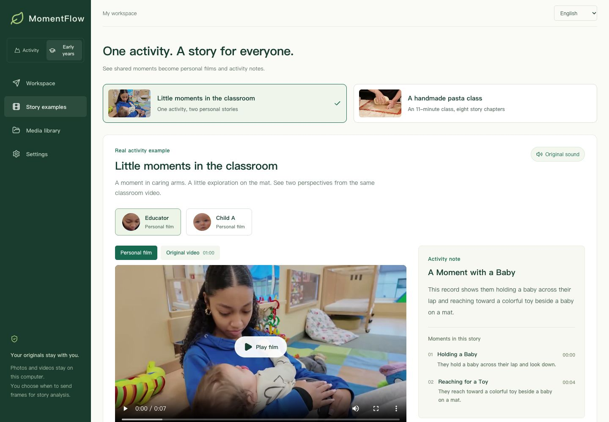
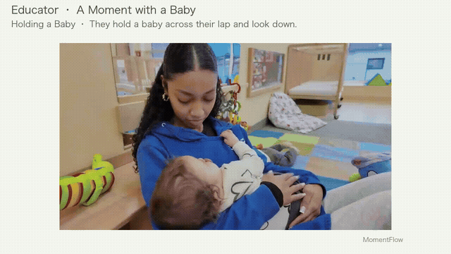

# MomentFlow

[简体中文](README.md) · [English](README.en.md)

**One shared activity. A personal story for everyone.**

MomentFlow organizes appearances across photos and videos, suggests highlights, drafts chapters and activity notes, and creates personal films with the original soundtrack. It supports kindergarten, camp, classroom and activity workflows.

This repository contains a working local application. Face processing and editing run on your computer; optional AI story analysis uses Luna through your own OpenRouter account. A person must review every film before delivery.

## See the results

### A bilingual story workspace



Four steps guide the workflow: **Add media → Confirm people → Create a story → Review and share**. Separate tabs keep story editing, clip selection and person review manageable.

### One source video, different personal films

[](demo/public/examples/classroom/educator-en.mp4)

The input is a **60-second report from a real childcare center**, including several people, caregiving and infant activity. Its recorded soundtrack, including narration, is preserved. No synthetic voiceover was added. These short films reflect the available footage, not a full week of observations.

| Example | Actual result | Watch |
| --- | --- | --- |
| Educator | 2 chapters, 7.5 seconds: holding a baby and interacting with a toy | [English film](demo/public/examples/classroom/educator-en.mp4) · [Chinese film](demo/public/examples/classroom/educator-zh.mp4) |
| Child A | 1 chapter, 4 seconds: activity on the mat | [English film](demo/public/examples/classroom/child-a-en.mp4) · [Chinese film](demo/public/examples/classroom/child-a-zh.mp4) |
| Handmade pasta class | 8 automatically selected chapters, 27 seconds, from an entire 11-minute class, covering preparation, cooking and tasting | [English film](demo/public/examples/kitchen/story-en.mp4) · [Chinese film](demo/public/examples/kitchen/story-zh.mp4) |

[Multi-person source video](demo/public/examples/classroom/source.mp4) · [Finished stories and chapter data](demo/public/examples/catalog.json) · [Classroom evaluation](demo/qa/classroom/README.md) · [Long-video and audio evaluation](demo/qa/real-activity/README.md)

Open **Story examples** in the app to switch people, compare the source, seek to chapters and download films. **Viewing saved examples needs no API key and makes no paid calls.** These are recorded results from actual processing. New uploads run through the real pipeline.

Classroom credits: Cherise Vaught / AFN Kaiserslautern / Defense Media Activity. The [publisher identifies the work as Public Domain](https://www.dvidshub.net/video/993791/ramstein-child-development-center-expands-childcare-support), subject to its [use restrictions](https://www.dvidshub.net/about/copyright). The appearance of U.S. Department of War (DoW) visual information does not imply or constitute DoW endorsement. Cooking credits: Northampton Community Television; presenter Laura Alpern; editor Julia Alpern; [CC BY 3.0](https://creativecommons.org/licenses/by/3.0/). Examples were adapted through editing and captions. No creator or organization endorsement is implied. See the [full media inventory](demo/public/examples/README.md).

## What works today

| Step | Implemented capability |
| --- | --- |
| Import | Mixed photos and local videos, preserving originals and source times |
| Organize people | YuNet detection, SFace features, conservative clustering, reference photos, manual merging and splitting |
| Create a story | Real Luna calls for sampled visual observations, duplicate removal, highlight selection, chapter order and Chinese or English notes |
| Make a film | Moving source footage, burned-in chapter captions, optional original sound, masking of detected other faces |
| Review and collect | Version-bound approval, delivery state, local collection page and MP4 download |
| Workspace | Chinese/English UI, progress, cancellation/retry, local persistence and browser-session isolation |

Pipeline: `Photos / videos → Appearances → Confirm people → AI draft → Edit and apply → Original-sound film → Review and collect`

## Quick start

Requirements: **Node.js 20.19+, Python 3.11–3.13, uv, FFmpeg and ffprobe**.

```bash
git clone https://github.com/UllrAI/momentflow.git
cd momentflow/demo
npm ci
npm run setup
npm run dev -- --port 4173
```

Open **http://localhost:4173** and choose **Story examples**. `setup` installs backend dependencies and downloads verified face models. `dev` starts the UI and local API together.

To process your own files:

1. Create a collection, confirm permission and add photos or videos.
2. Find people. Review their appearances and combine or separate groups when needed.
3. Save your OpenRouter key in Settings. Open a person’s Story tab, consent to sending selected frames, then request and edit the story. Manual selection is available in Clips.
4. Apply the story and create the film. Watch it fully, review captions, sound and other-face masking, then approve, share and download.

The interface language determines the language of newly generated stories. Changing the UI language does not rewrite saved names, collection titles or stories.

Local detection, manual selection and editing need no key. AI analysis may incur OpenRouter charges. Never commit API keys.

## Data and limitations

- **Local storage:** originals, face features and output files are kept in the Git-ignored `.momentflow-data/` directory. Detection and editing do not upload the original video. Signed sessions separate browsers locally; they are not a production account system.
- **Explicit AI consent:** analysis sends sampled frames from at most 36 dispersed candidates, up to 3 frames per video segment. Names, reference photos, face vectors and original audio are not sent. This is not full-video or speech understanding.
- **Human identity review:** side views, blur and occlusion can cause missed faces or fragmented groups. The cooking evaluation produced 287 fragments that required manual review and merging before automatic selection. This does not establish unattended commercial recognition quality.
- **Editing limits:** activities without visible faces may be missed; short cuts can interrupt speech. Masking only covers detected faces and must be reviewed. Notes must not be used to assess children’s personality, ability or development.
- **File limits:** 100 MB/file, 5 minutes/video, up to 4K; 30 files and 500 MB/collection. Films are limited to 60 seconds and exported as 720p, 12 fps H.264/AAC MP4.
- **Not integrated:** live camera streams, speech analysis, cloud storage, real family/guest accounts, cross-device invitations or payments. `npm run build` packages the frontend only; static hosting cannot run the Python/FFmpeg pipeline by itself.

## Development and documentation

```bash
cd demo
npm test
npm run check:backend
npm run check:format
npm run build
npm run test:sites
```

Backend tests run real local recognition and FFmpeg. Model transport unit tests use an explicit test double; actual model evaluations are recorded separately under QA.

```text
backend/             Local API, recognition, stories and rendering
  momentflow/
  tests/
demo/                React workspace and collection page
  src/               UI and Chinese/English messages
  public/examples/   Curated public media and real finished outputs
  qa/                Evaluation data and UI evidence
docs/                Product, implementation, research and screenshots
design/              Visual direction and archived concepts
```

| Document | Contents |
| --- | --- |
| [Application guide](demo/README.en.md) | Setup, configuration, storage and verification |
| [Processing pipeline](docs/implementation-v3.md) | Import, detection, corrections, rendering and version boundaries (Chinese) |
| [Stories and original audio](docs/implementation-v4-story.md) | Evidence constraints, selection, chapters and audio (Chinese) |
| [UI verification](demo/design-qa.md) | Visual comparison, language and interaction checks |
| [Product design](docs/product-design-v2.md) | Immediate and periodic workflows and data model (Chinese) |
| [Market entry research](docs/research/market-entry-deep-dive-2026-10-24.md) | Buyers, competition and sales friction (Chinese) |
| [Cross-scenario landscape](docs/research/cross-scenario-landscape-2026-10-24.md) | Venues, camps, events and competing products (Chinese) |

## Open-source preparation and licensing

The project code does **not yet have an open-source license**. Third-party model or sample-media licenses do not license the application code. Before a public release, choose the code license, review third-party media and depicted-person rights, and assess production authentication and access controls. This update does not change repository visibility.

YuNet, SFace and existing samples retain their individual licenses. See the [media inventory](demo/public/examples/README.md) for new sources and adaptations. Runtime originals, credentials, embeddings and model weights are excluded from Git. Only deliberately curated public demonstration fixtures are included.
