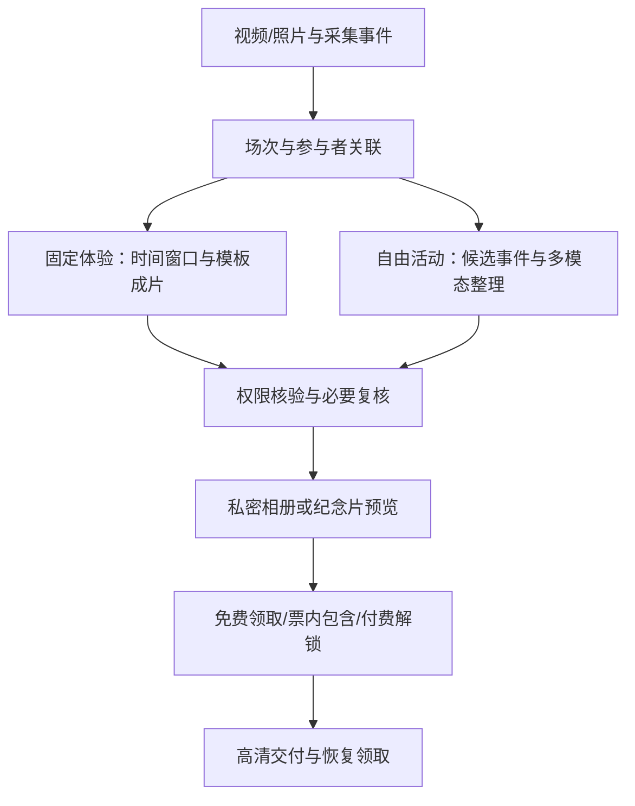
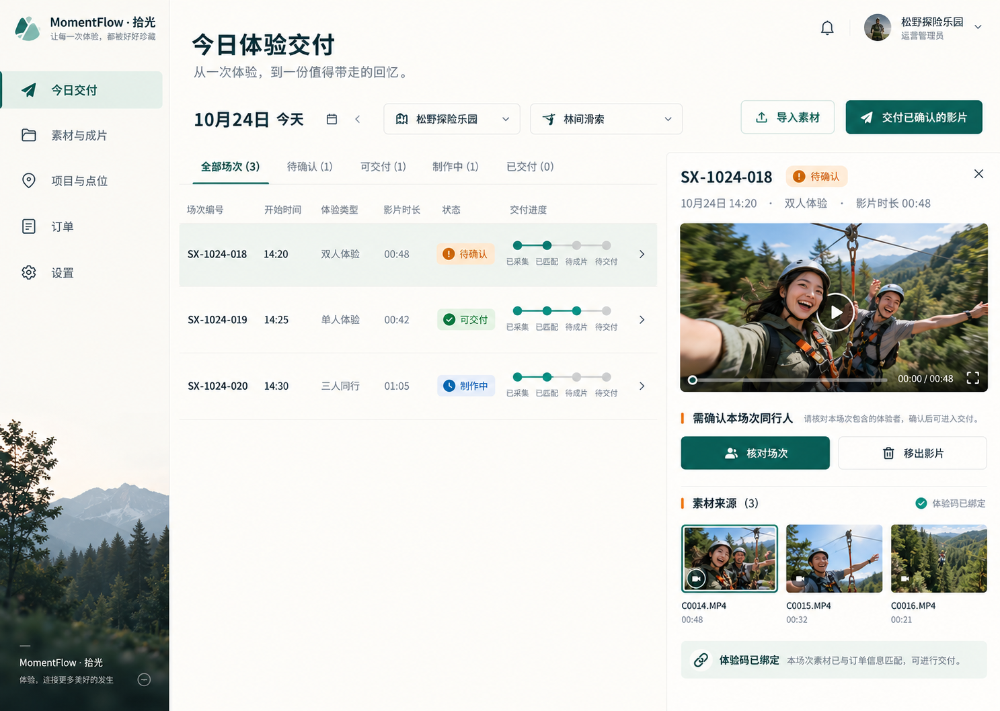
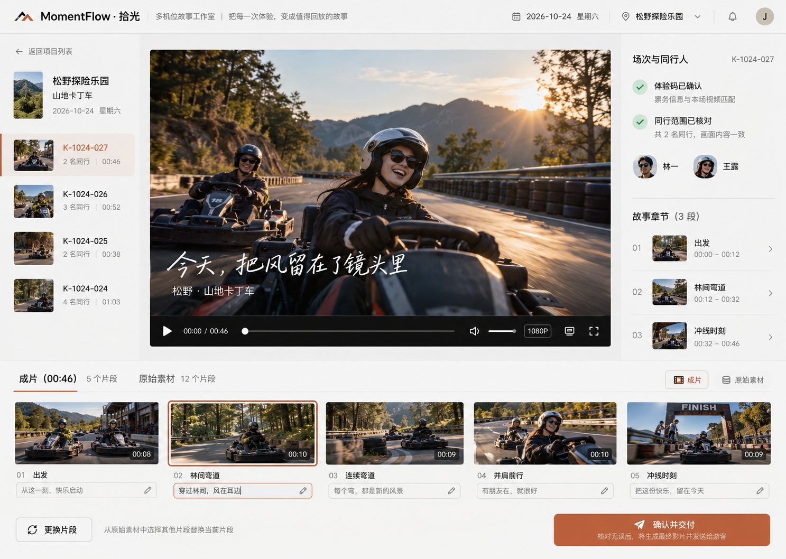
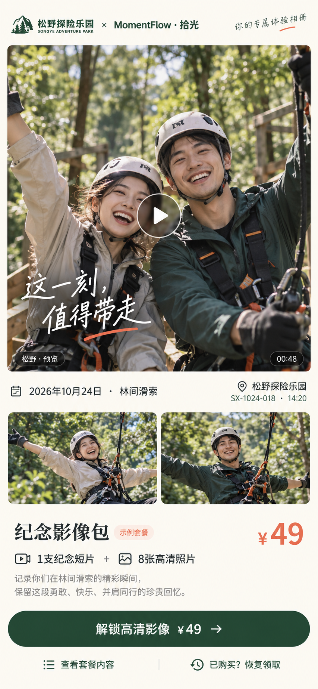

# MomentFlow · 拾光

让一次体验里属于你的照片和视频，自动汇成可以领取、保存或购买的个人回忆。

面向场馆、体验项目、营地及活动组织者的个人体验影像平台。覆盖游乐项目纪念片、活动个人相册、结营/研学合辑和幼儿园成长周记。

> 当前阶段：已实现本地照片/视频导入、真实人脸检测与聚类、人物核对、原片个人集锦生成及审核领取，包含体验和幼儿园 Demo。没有接入实时监控、云端账户/监护体系或真实支付。

## 运行真实处理 Demo

前置：Node.js、Python 3.11–3.13、uv、FFmpeg/ffprobe。无需云端识别 Key。

```bash
cd demo
npm ci
npm run setup
npm run dev -- --port 4173
```

打开 http://localhost:4173 。默认进入幼儿园场景，可切换体验影像。点击“打开幼儿园示例”，会实际加载模型分析示例媒体；也可以新建批次导入自己的授权照片和视频。

演示流程：**照片/视频导入 → YuNet 检测 → SFace 特征与聚类 → 核对/纠错人物 → 选段 → 生成真实 MP4 → 审核交付 → 每人专属领取**。

素材、特征、人物与输出保存在本机，刷新/重启后保留。幼儿园示例儿童为 AI 虚构，示例视频由照片合成；另用公开授权真人动态视频验证原视频识别与剪辑。相似人物、遮挡和低清仍需人工复核，当前没有经过真实幼儿园识别效果验证。

详见 [Demo 运行与边界](demo/README.md)、[真实处理链路](docs/implementation-v3.md)、[验收记录](demo/design-qa.md)。

## 从哪里开始

先验证一个起止明确、有拍摄授权的体验项目：体验码绑定场次和设备，采集照片/视频，生成纪念片，通过私密页面领取或购买。先跑通正确关联、成片、交付和异常恢复，再增加点位或行业。

已有幼儿园/营地渠道时，也可先验证周期合辑；不需要为了扩大定位而放弃已有客户优势。

## 两种生产模式



关联支持二维码、RFID、订单/场次、人工标记和授权的视觉匹配。人脸不是必填项，大模型也不是每段固定体验视频必须经过的实时步骤。素材匹配、账户认证、内容使用权和下载权益分别管理。

## 调研与产品资料

| 资料 | 内容 |
|---|---|
| [市场深入比较与切入建议 · 2026-10-24](docs/research/market-entry-deep-dive-2026-10-24.md) | 九类场景的规模证据、购买者、竞争与销售阻力；付费场景测算、首单客户画像和验证计划 |
| [跨场景竞品与市场调研 · 2026-10-24](docs/research/cross-scenario-landscape-2026-10-24.md) | Disney、Universal、Revl、Pomvom、PicThrive、营地/赛事/活动产品和国内方案；证据边界、公开收费、技术路线和市场切入判断 |
| [产品设计 v2](docs/product-design-v2.md) | 跨场景定位、即时/周期流程、运营端与游客端、数据模型、订单权益、技术架构、异常恢复和试点标准 |
| [本轮视觉生成记录](design/generation-prompts.md) | 运营交付、成片工作室与游客领取页的概念提示词 |
| [幼儿园 v1 · 历史方案](docs/archive/kindergarten-product-design-v1.md) | 保留幼教场景的教师审核、监护关系与观察证据设计 |
| [幼儿园 v1 · 历史视觉](design/archive/kindergarten/generation-prompts.md) | 原始三张幼教概念及生成记录 |

## 核心触点概念

以下三个触点是同一产品的视觉方向。Demo 已实现其核心业务流程；实际功能范围以 Demo 说明为准，概念中的视频采集、识别等能力尚未接入。

### 运营交付工作台

处理场次绑定、缺片与交付待办，审核可交付影片。



### 成片工作室

核验场次与同行范围，查看原片，更换片段并确认成片。



### 游客私密领取页

观看本人/授权同行纪念影像，按服务模式领取、购买或恢复下载。



## 验证重点

最新研究将首批客户进一步限定为“已有拍摄素材、已有影像收费或明确交付义务、负责人可决策”的体验运营商；稳定期次的营地/研学机构作为第二条验证路径。国内已有低价人脸检索、找视频及快剪平台，不把基础功能当作已证明的竞争壁垒。

- 可服务体验中实际拍到多少，关联是否正确，未知/待核验是否被准确保留。
- 采集到可领取预览的端到端时延，峰值与断网情况下能否恢复。
- 实际预览、领取、实收购买、退款与高清交付，避免把游客数直接算成收入。
- 未售媒体、设备/现场服务、推理、渲染、存储和流量的完整成本。
- 参与者、同行、监护关系、拍摄用途及接收权限是否可执行、可修正、可撤回。

详细目标和演示商业计算均为待验证假设。竞品公开资料不等同于我们已经实现或已经证明的能力。

产品与仓库工作名为 MomentFlow；未完成商标/域名核验。当前方案日期：2026-10-24。
