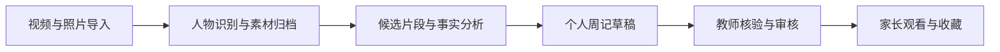
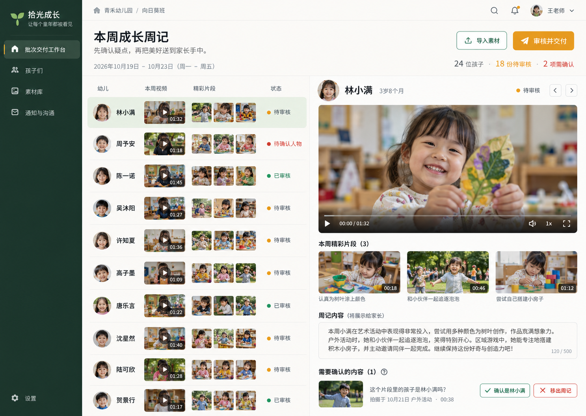
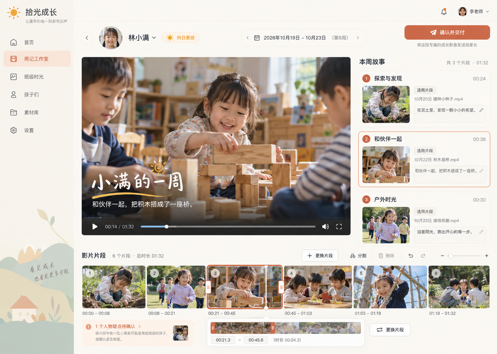
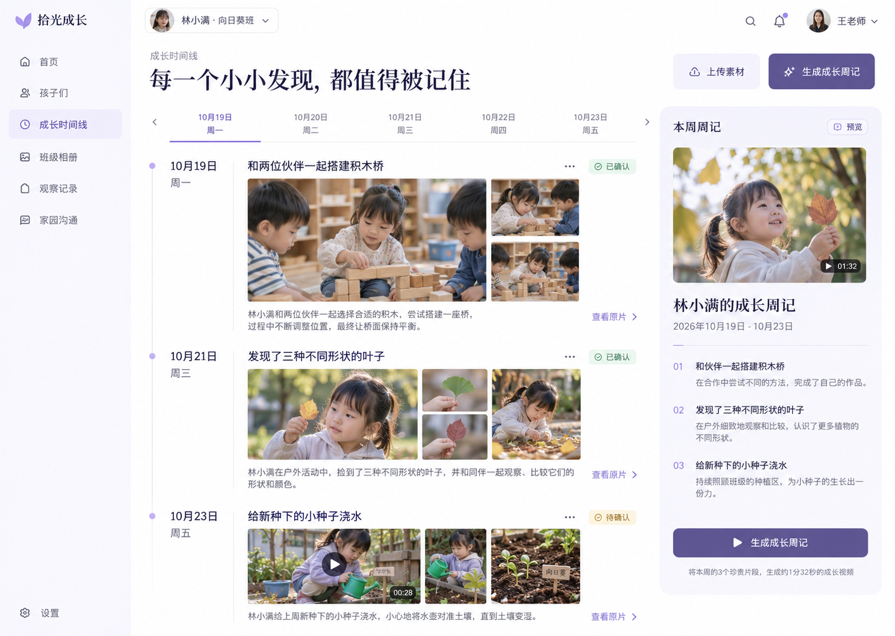

# 拾光成长 · Shiguang Growth

把园内分散的照片和视频，整理成每个孩子有原始依据、经老师确认的成长周记。

面向幼儿园的个人成长影像产品，覆盖园所 Web 工作台、教师手机端和家长小程序。

> 当前阶段：产品设计与视觉探索。仓库包含设计资料，尚未实现可运行应用、真实人脸识别、媒体处理服务或家长交付系统。概念图使用 AI 生成的虚构人物与示例数据。

## 核心流程

输入覆盖监控视频、活动摄像视频和活动摄影图片。先建立带时间戳的人物、活动和证据索引，再进行个人选材、编排与渲染。同一活动可以关联多个孩子，减少重复分析。

## 设计资料

| 资料 | 内容 |
|---|---|
| [完整产品设计方案](docs/product-design-v1.md) | 用户与权限、端侧结构、完整流程、页面、技术架构、数据模型、异常状态、版本范围、收费假设与试点标准 |
| [视觉概念与生成记录](design/generation-prompts.md) | 内置 ImageGen 的生成提示词与图片对应关系 |

三种界面方向仍处于比较阶段，尚未选择实现方向。概念图用于表达布局与风格，最终交互、状态和文案以产品方案及后续评审为准。

### 批次交付工作台

围绕班级周记批次组织老师待办、人物确认、审核与交付。

### 故事剪辑台

围绕单个孩子的周记预览、片段替换与简化编排展开。

### 成长证据时间线

围绕一周真实活动及原片证据浏览、确认和生成周记。

## 首个可付费版本

- 园所、班级、教师和监护人关系管理，明确素材用途与授权。
- 视频和照片上传，已知孩子参考库、人物归类、身份疑点与人工纠正。
- 候选片段、多模态事实描述和个人周记草稿。
- 教师审核、成片渲染、家长交付、版本修正与撤回。
- 原始素材到衍生内容的血缘、失败重试和单园成本记录。

监控首先支持授权导出的文件，并在试点中验证一个明确标准的持续接入路径。成长观察记录独立保留完整证据并由教师核验，不能直接把精选集锦当作完整的发展评价依据。

## 待验证事项

以真实试点验证儿童身份识别、可交付素材覆盖、教师总工时、家长观看价值、实际付费和单园单位经济。文档中的报价、目标时长和验收阈值属于待验证的设计假设。

人脸识别代码、模型权重和训练数据的授权需分别核验；真实儿童素材的采集、分析、传输与交付需结合实际场景确认适用规则。

## 后续工作

选择界面方向后制作交互原型，再用授权的真实素材验证人物归类和周记生产流程。

产品名为工作名，未作商标核验。初版设计日期：2026-10-23；仓库整理日期：2026-10-24。
