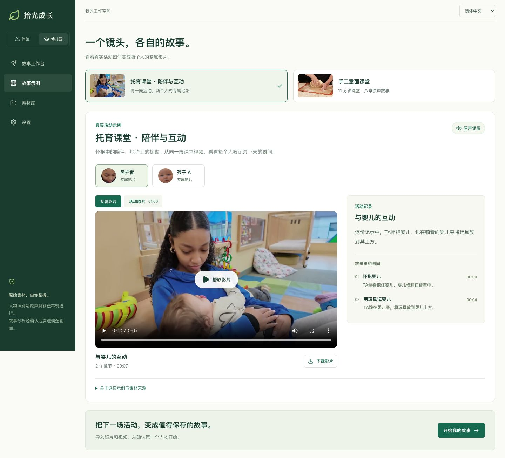
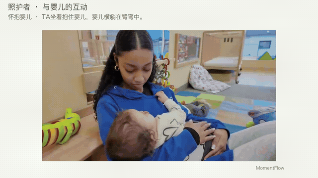

# MomentFlow · 拾光

[简体中文](README.md) · [English](README.en.md)

**把一次共同的活动，整理成每个人自己的故事。**

MomentFlow 从照片和视频中整理人物出镜记录，辅助挑选精彩片段、编排章节和撰写活动记录，生成保留原声的个人影片。适用于幼儿园日常、营地、课堂和体验活动。

目前提供可运行的本地应用：人脸识别与剪辑在本机完成，AI 故事分析通过你自己的 OpenRouter 账户调用 Luna。所有影片交付前都需人工核对。

## 效果展示

### 双语故事工作台



四步完成制作：**导入素材 → 确认人物 → 整理故事 → 审核交付**。界面支持中文与英文切换，故事、选片和人物核对分区编辑。

### 同一段活动，不同人的影片

[](demo/public/examples/classroom/educator-zh.mp4)

实际输入为一段 **60 秒的真实托育中心报道**，包含多人同框、照护互动和婴儿活动。示例保留来源录音，包括报道旁白；没有添加合成配音。原片较短，成片只记录拍到的活动，不包装成完整一周的观察。

| 示例 | 实际输出 | 观看与数据 |
| --- | --- | --- |
| 照护者 | 2 章、7.5 秒；怀抱婴儿、与玩具互动 | [中文影片](demo/public/examples/classroom/educator-zh.mp4) · [English film](demo/public/examples/classroom/educator-en.mp4) |
| 孩子 A | 1 章、4 秒；地垫上的活动记录 | [中文影片](demo/public/examples/classroom/child-a-zh.mp4) · [English film](demo/public/examples/classroom/child-a-en.mp4) |
| 手工意面课堂 | 完整 11 分钟录像中自动选出 8 章、27 秒，包含准备、操作和品尝 | [中文影片](demo/public/examples/kitchen/story-zh.mp4) · [English film](demo/public/examples/kitchen/story-en.mp4) |

[多人课堂原片](demo/public/examples/classroom/source.mp4) · [成品与章节数据](demo/public/examples/catalog.json) · [课堂实测记录](demo/qa/classroom/README.md) · [长视频分析与原声验证](demo/qa/real-activity/README.md)

应用的“故事示例”页可以切换人物、对照原片、点击章节播放并下载影片，**查看成品不需要模型 Key，也不会调用付费接口**。这些是实际处理后保存的示例；导入新素材会重新运行识别与分析。

素材署名：托育课堂由 Cherise Vaught / AFN Kaiserslautern / Defense Media Activity 制作，[原发布页](https://www.dvidshub.net/video/993791/ramstein-child-development-center-expands-childcare-support)标注 Public Domain；适用[来源使用限制](https://www.dvidshub.net/about/copyright)。The appearance of U.S. Department of War (DoW) visual information does not imply or constitute DoW endorsement. 烹饪课堂由 Northampton Community Television 制作，Laura Alpern 出镜、Julia Alpern 剪辑，按 [CC BY 3.0](https://creativecommons.org/licenses/by/3.0/) 使用。两份示例均经过剪辑与字幕等改编，不代表原作者或机构背书。[完整素材说明](demo/public/examples/README.md)。

## 已实现的功能

| 环节 | 当前能力 |
| --- | --- |
| 素材导入 | 照片与本地视频混合导入，保留原文件和来源时间 |
| 人物整理 | YuNet 检测、SFace 特征、保守聚类；参考照片、人工合并与拆分 |
| 故事助手 | 实际调用 Luna 分析候选画面、去重、挑片、编排章节及起草中文或英文记录 |
| 影片制作 | 动态原片剪辑、章节字幕、原声保留；检测到的非目标人脸遮盖 |
| 审核领取 | 版本审核、交付状态、本机领取页和 MP4 下载 |
| 工作空间 | 中英文界面、任务进度、取消重试、本地持久化及浏览器会话隔离 |

流程：`照片 / 视频 → 出镜记录 → 人物核对 → AI 故事草稿 → 编辑确认 → 原声影片 → 审核领取`

## 快速开始

需要 **Node.js 20.19+、Python 3.11–3.13、uv、FFmpeg 和 ffprobe**。

```bash
git clone https://github.com/UllrAI/momentflow.git
cd momentflow/demo
npm ci
npm run setup
npm run dev -- --port 4173
```

打开 **http://localhost:4173**，进入“故事示例”即可观看成品。`setup` 安装后端依赖，下载并校验人脸模型；`dev` 同时启动界面与本地 API。

处理自己的素材：

1. 新建活动，确认素材处理权限，导入照片和视频。
2. 开始人物识别，核对每个人的出镜记录；有需要时合并或拆分。
3. 在“设置”填写自己的 OpenRouter Key。回到人物的“故事”标签，确认候选画面发送范围，推荐并编辑故事。也可以在“片段”中手动选片。
4. 采用故事后生成影片，完整检查画面、字幕、原声和其他人物遮盖，再审核、交付与下载。

中文或英文界面会用于新生成的故事。切换界面语言不会改写你已经保存的姓名、活动名或故事内容。

本地识别、手动选片和剪辑无需 Key；AI 分析可能产生 OpenRouter 费用。不要把密钥写入代码或提交到 Git。

## 数据与能力边界

- **本地保存**：原始素材、人物特征与输出保存在被 Git 忽略的 `.momentflow-data/`。识别和剪辑无需上传原片。签名会话用于隔离本机不同浏览器的数据，不能替代生产账号体系。
- **按次同意 AI 分析**：最多发送 36 个分散候选的采样画面，视频每段最多 3 帧；不发送姓名、参考照片、特征向量或原声。不是全量视频或语音理解。
- **人物核对不可省略**：侧脸、低清与遮挡可能漏检或造成分组碎片化。烹饪实测出现 287 个碎片组，经人工复核合并后才自动选片；不能据此宣称已支持无人审核的商用识别。
- **自动剪辑仍有限制**：检测不到人脸的活动可能缺失，短片可能截断对白。自动遮盖只覆盖检测到的人脸，必须复核；文案不能作为儿童能力、性格或发展评价。
- **文件限制**：单文件 100 MB、单段视频 5 分钟、最高 4K；每活动 30 份、总计 500 MB。成片最多 60 秒，输出 720p、12 fps、H.264/AAC MP4。
- **尚未接入**：监控实时流、语音语义分析、云端存储、真实家长/游客账号、跨设备邀请与支付。`npm run build` 仅打包前端，静态托管不能独立运行 Python/FFmpeg 链路。

## 开发与文档

```bash
cd demo
npm test
npm run check:backend
npm run check:format
npm run build
npm run test:sites
```

后端测试会实际调用本地识别和 FFmpeg；模型接口单元测试使用明确的测试替身，不作为实际 AI 效果证据。真实模型实测另存于 QA 记录。

```text
backend/             本地 API、识别、故事与渲染
  momentflow/
  tests/
demo/                React 工作台与领取页
  src/               界面、中英文文案
  public/examples/   经整理的公开素材与真实成品
  qa/                实测数据与界面验收证据
docs/                产品设计、实现、市场研究与演示图
design/              视觉方向与历史概念
```

| 文档 | 内容 |
| --- | --- |
| [应用使用与开发](demo/README.md) | 安装、配置、数据管理和验证 |
| [真实处理链路](docs/implementation-v3.md) | 导入、识别、人物纠错、渲染及版本边界 |
| [故事分析与原声](docs/implementation-v4-story.md) | 证据约束、选片、章节与音频处理 |
| [界面验收](demo/design-qa.md) | 视觉对照、双语与交互测试 |
| [产品设计](docs/product-design-v2.md) | 即时影像与周期故事的产品流程和数据模型 |
| [市场切入研究](docs/research/market-entry-deep-dive-2026-10-24.md) | 场景、购买者、竞争和销售阻力 |
| [跨场景竞品研究](docs/research/cross-scenario-landscape-2026-10-24.md) | 体验场馆、营地、赛事与活动产品 |

## 开源准备与许可

当前尚未为项目代码指定开源许可证；请勿把第三方模型或示例素材的许可证视为本项目代码许可。后续公开前仍需确定代码许可证、完成第三方素材与人物权利检查，以及生产部署的账号和访问控制评审。当前修改不改变仓库可见性。

YuNet、SFace 及现有示例分别保留其许可证；新增公开素材和改编说明见 [素材清单](demo/public/examples/README.md)。运行时原片、密钥、特征向量和模型权重不进入 Git；仓库仅包含专门整理用于展示的公开示例。
