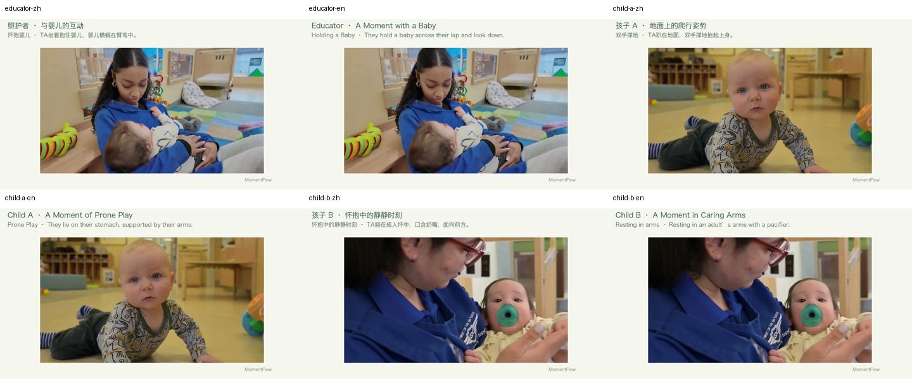

# 真实多人托育课堂实测 / Real multi-person classroom evaluation

日期 / Date: 2026-10-24

## 输入与流程

输入为 Cherise Vaught / AFN Kaiserslautern / Defense Media Activity 制作的 [60 秒托育中心报道](https://www.dvidshub.net/video/993791/ramstein-child-development-center-expands-childcare-support)。原发布页标注 Public Domain，[素材说明与非背书声明](../../public/examples/README.md)。完整转码后原片位于 [source.mp4](../../public/examples/classroom/source.mp4)，哈希见 [report.json](report.json)。来源录音包含报道旁白，不能把它说成纯环境声。

完整原片导入 → 0.5 秒采样 → 实际 YuNet/SFace → 人物视觉复核 → 对同一照护者的三个分散组执行两次合并 → 确认人物 → 实际 OpenRouter / `openai/gpt-6-luna` → 自动选片与草稿 → 采用 → 原声 MP4 → 审核交付 → 从领取接口下载并与仓库成片比对。

自动检测 102 张脸，形成 15 个组；没有降低质量门槛来增加命中。照护者在 28 秒、49 秒与 52 秒的分组经逐张查看后合并；婴儿分组分别保留。不推断真实姓名，称呼仅为示例标签。其他人物的未确认分组保留在本机项目中，不伪装为自动确认。

## 实际结果与失败边界

| 人物 | 中文 | 英文 | 产品示例 |
| --- | --- | --- | --- |
| 照护者 | 2 章、7.5 秒 | 独立英文分析，2 章、7.5 秒 | 展示 |
| 孩子 A | 1 章、4 秒 | 独立英文分析，1 章、4 秒 | 展示 |
| 孩子 B | 首次只选出 0.5 秒 | 两次英文分析未找到可用故事；新的中文结果经人工忠实翻译并通过正常草稿接口渲染为 3 秒 | 不展示过短结果，保留文件与失败说明 |

所有标题、记录和章节均可在 [成品 JSON](../../public/examples/classroom/) 查看。孩子 B 的英文 JSON 显式保留 `translation_method`，不声称其英文分析成功。没有为了填满时长编造故事、补配音或复制静态画面。



## 原声与文件验证

[音频验证数据](audio-verification.json) 检查产品中六份中英文成片的 H.264/AAC 编码、音视频时长及完整解码无警告；其中六份影片逐章节对照仓库所含完整来源的对应音频；烹饪按 `original_start` 对齐原片，观看副本另行转码。烹饪片另外有完整 [八段波形实测](../real-activity/report.json)。每段先生成精确样本数的 PCM，拼接后只编码一次 AAC。课堂对应相关系数为 0.999330–0.999591，在 8kHz 精度下偏移为 0ms。烹饪观看副本另行转码，与成片的相关系数为 0.935534–0.999026、偏移绝对值最高 20.25ms；这是观看副本对照，不替代长视频报告中的实际导入源验证。

从仓库根目录可重新验证，不调用模型：

```bash
uv run --directory backend python ../demo/scripts/verify-examples.py
```

浏览器测试包括：中英文切换与刷新保留、不同人物独立影片、原片播放、章节在成片与原片的正确时间定位、非静音播放、MP4 下载，以及正常审核领取接口。

这些短片证明实际链路可运行，不是儿童识别准确率评测，也不代表一整周的素材覆盖。原声没有按句子优化，遮盖不能保证零漏检；真实使用仍需人物、画面、文字、声音与接收范围审核。

## English overview

The complete 60-second childcare report was processed through real YuNet/SFace at 0.5-second sampling. It produced 102 face crops and 15 groups. Three fragmented groups belonging to the educator were visually reviewed and combined through two normal merge operations. Quality thresholds were unchanged. Anonymous labels do not identify real people.

Actual Luna calls produced separate Chinese and English educator films (2 chapters, 7.5 seconds) and Child A films (1 chapter, 4 seconds). Child B’s first Chinese selection was only 0.5 seconds and is excluded from the gallery. Two English analysis attempts found insufficient usable evidence. A fresh Chinese draft was later faithfully translated and rendered through the normal editing API, with a `translation_method` marker. No failed analysis is presented as a successful English model result.

The original soundtrack includes narration. All six featured films pass codec, duration and full-decode checks. Every featured chapter is also compared with the corresponding audio in the bundled source (absolute original times for cooking); metrics and hashes are in `audio-verification.json`. Browser tests cover language persistence, people switching, source/film seeking, unmuted playback and downloads. These results do not establish recognition accuracy, full-week coverage or unattended production readiness. Source credits, restrictions and the exact non-endorsement notice are retained in the linked media inventory.
