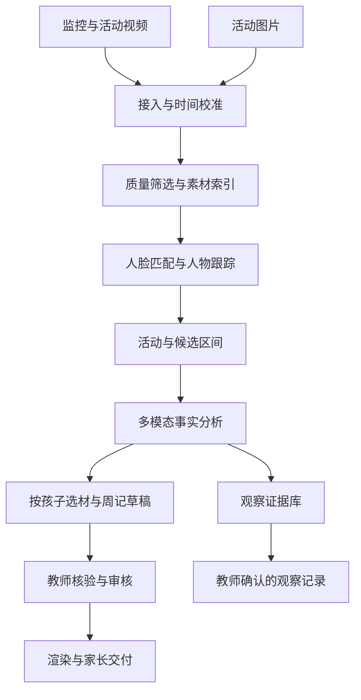

# 拾光成长｜产品设计方案 v1.0

设计日期：2026 年 10 月 23 日。产品名为工作名，未作商标核验。本文是可供讨论、评审与开发拆解的产品方案；性能、收费和试点指标均为待验证假设，不代表已经实现的能力。

## 1. 产品定义与关键决策

**把园内分散的照片和视频，整理成每个孩子有原始依据、经老师确认的成长周记。**

对园所，交付的是教师减负和稳定的家长服务；对家长，交付的是自己孩子值得保存的真实记录。底层以可追溯的个人素材库为基础，周记是主要交付物，教育观察记录是独立的后续输出。

| 决策 | 设计结论 | 理由 |
|---|---|---|
| 第一购买者 | 园所，优先有持续拍摄和家长分享习惯的园所 | 园所拥有素材入口、教师工作流和家长触达渠道 |
| 第一使用者 | 班主任和配班老师 | 是否省时间决定能否持续使用 |
| 核心交付 | 每个孩子每周一份图文＋视频成长周记 | 频率明确，成果可感知，可与现有手工流程比较 |
| 产品形态 | 园所 Web 工作台＋教师手机上传/快审＋家长微信小程序 | 桌面适合批量处理，手机适合现场采集和观看 |
| 自动化边界 | 自动整理与起草，教师确认后交付 | 身份、素材范围和文字事实必须能修正 |
| 内容表达 | 客观、具体、温暖；保留原声和真实过程 | 避免空泛夸赞、心理推断和模板感 |
| 发展评价 | 独立证据库与教师观察流程 | 精彩集锦的选择偏差不适合作为完整评价依据 |
| 首批客户 | 有素材、有明确负责人、愿意提供真实试用反馈并付费的园所 | 先验证持续生产和支付，避免只完成展示样片 |

第一承诺是“找到、整理、交付”，不是凭单个片段判断儿童能力。系统应对没有拍到、识别不清和素材不足诚实呈现。

## 2. 角色与权限

| 角色 | 主要任务 | 权限边界 |
|---|---|---|
| 园长/园所管理员 | 开园、建班、邀请教师、配置来源和交付规则、查看使用情况 | 管理本园；跨园访问需显式授权，不默认互通 |
| 班主任 | 确认人物、审核周记、发布与撤回 | 默认只管理授权班级 |
| 配班老师 | 上传、补充背景、纠正素材 | 能否交付由园所配置 |
| 摄影贡献者 | 向指定活动或班级上传照片/视频 | 不可浏览其他班级、孩子人脸库或家长资料 |
| 家长/监护人 | 管理本孩子授权，观看、收藏和保存已交付周记 | 只看到已授权交付内容，不提供全班人脸搜索和原监控入口 |
| 支持人员 | 排查任务状态 | 默认无儿童原片和人脸访问权限；必要支持使用限时授权并留痕 |

家长与孩子是多对多关系：一个孩子可能有多个监护人，一个监护人可能有多个孩子。班级和教师关系保留生效时间，避免转班后继承错误访问权。

## 3. 产品结构

### 园所 Web 工作台

- **本周交付**：默认首页，按孩子查看待办、周记和审核状态。
- **素材库**：视频、图片、活动、拍摄来源与处理状态。
- **孩子档案**：已确认素材、周记历史、参考照及身份纠正。
- **观察记录**：完整证据、教师备注和核验后的观察条目。
- **园所设置**：班级、成员、来源接入、监护人授权、存储和交付规则。

身份疑点、失败任务和交付问题在对应工作流内解决，不额外建立大量抽象管理模块。首页不以模型调用量、token 或硬件指标占据主要位置。

### 教师手机端

首页提供“拍摄/上传”“补充活动信息”“处理待确认”“预览本周周记”。支持批量上传、断点续传和稍后补充信息。拍摄时不要求老师逐一手工标记所有孩子。

### 家长小程序

默认展示“孩子的本周周记”，其次是历史时间线和收藏。孩子切换放在顶部，仅在绑定多个孩子时显示。授权与数据管理在“我的”中保持可达。

## 4. 完整用户旅程

### 4.1 开园与首次设置

1. 管理员创建园所和班级，批量导入孩子基本名单，邀请教师。
2. 按素材采集、人物匹配、分析、家长交付等实际用途配置告知和授权，绑定监护人。
3. 由园所/监护人提供参考照，老师确认身份。建议收集多角度清晰照片；实际张数以测试效果为准。
4. 接入活动素材上传，并评估监控来源的适用范围、画面质量和可使用用途。
5. 生成一份演示周记，老师完成第一次确认，管理员确认交付规则。

授权未完成的孩子不进入自动身份匹配和家长交付流程；系统提供符合园所规则的手动归档路径。园所采集和处理的合法依据需结合实际场景确认，参考照授权不能被当成所有用途的通行授权。

### 4.2 日常采集与整理

老师/摄影人员上传，或授权来源定时导入 → 校验文件与时间 → 自动归类人物和活动 → 将疑点集中成少量可操作待办。

导入表单只要求“班级/活动”和文件，日期尽量从文件读取；读取失败或时钟异常时再询问。活动名称、地点、教师背景说明为可补充项。监控来源预设可处理时间段和区域，不默认全天、全空间采集。

上传后明确展示“上传中 / 正在整理 / 可查看 / 需要处理 / 失败”，长任务允许离开页面，回来后可继续。单个坏文件不阻塞整批素材。

### 4.3 每周审核与交付

1. 按园所时区和设定周期生成班级周记批次；默认工作周，不固定依赖星期五上课。
2. 老师先处理会影响交付的阻塞问题：人物不确定、授权失效、素材不可用。
3. 进入每个孩子的周记，预览视频与配文，替换/移除片段、调整顺序、修正文字。
4. 审核通过的周记进入“可交付”；未完成的保留草稿，不因批次发布被自动放行。
5. 老师查看交付清单，明确本次孩子、接收家庭、份数与未交付原因，再执行交付。
6. 交付后记录状态；老师可以撤回、修正并交付新版本。

首版不采用无人审核自动发布。后续可基于明确授权和验证结果探索低风险自动交付规则，但不能绕过阻塞条件。

### 4.4 家长观看

家长收到园所服务通知 → 打开孩子本周周记 → 播放真实片段＋浏览本周照片与老师寄语 → 收藏或按授权保存 → 查看历史周记。

家长展示标题示例：“小满的一周”。配文示例：“这周，小满和两位伙伴一起搭建了积木桥，也给新种下的种子浇了水。”

拍摄不足时直接展示照片或图文周记，不硬凑视频；无合适内容时说明“本周暂未收录足够素材”，不伪造记录。家长可以提交“这不是我的孩子/配文有误/希望移除”的反馈，进入老师待办。

## 5. 核心页面设计

### 5.1 本周交付：首页

页面任务：让老师知道还差什么，快速完成本周交付。

- 顶部：园所、班级、周期；主要入口“导入素材”。
- 标题：“本周成长周记”；简洁进度：“24位孩子 · 18份待审核 · 2项需确认”。均为示例数据。
- 分组：需要处理、待审核、可交付、已交付；按状态组织，不给孩子能力排名。
- 每个孩子一行：姓名、封面、时长、代表片段、状态、明确的下一步操作。
- 选中孩子后在右侧查看周记预览和说明，减少来回跳页。
- 交付按钮清楚显示范围，例如“交付已审核的6份”，并在清单中列出跳过的项目。

素材数量、活动覆盖仅用于教师检查拍摄遗漏。对家长不展示全班比较、曝光排行榜或“发展分数”。

### 5.2 周记审核页

主区是成片预览，下方是简化片段列表：缩略图、活动描述、时长、来源。右侧为可编辑标题、寄语与事实待确认项。

核心操作：播放原片、替换片段、移除、调整顺序、微调起止、修改文字、确认审核。默认提供少量高质量替代项，不要求老师从海量库重新搜寻。

AI 建议与老师确认清晰区分；身份框和内部置信度只出现在核验视图，家长成片中不展示。

### 5.3 人物确认页

展示待确认画面及前后短片、参考照片和可选身份；操作为“确认是某孩子”“选择其他孩子”“无法确认”“移出本次周记”。

同时支持拆分误合并的人物、合并同一孩子的碎片。修改影响范围先明确：只修正本次片段，或修正相关连续轨迹；不默默全库覆盖。不用未经确认的照片自动更新参考库。

### 5.4 素材库

按日期/活动浏览，支持人物、媒体类型、来源与处理状态筛选。多孩子素材只保存一个主对象，以关联方式出现在各自档案。原片与衍生版本之间可追溯。

### 5.5 家长周记页

移动端首屏：孩子与周期 → 大幅视频封面与播放 → 老师寄语 → 本周精选照片。下方为历史周记。主要动作是观看和收藏，避免信息流、复杂编辑器和多余运营弹窗。

保存/转发权限由实际授权和园所策略决定；导出时可设置园所水印和接收者水印，但水印不代替访问控制。多人同框素材必须按全部出镜者的授权范围处理，必要时换片、裁切或遮挡。

## 6. 内容生产与技术流程

### 6.1 接入与预处理

- 视频和图片共用素材管理，但使用不同分析路径。
- 活动摄像用镜头变化、音频与时间信息分段；固定监控使用活动变化、人物出现与重叠窗口，不能只依赖切镜头。
- 时间保留原始时间、校准偏差、标准时间和所在时区。时钟异常需修正或标为不确定。
- 原始媒体保留；代理视频和缩略图用于浏览和分析。精细画质筛选不能把尚需身份确认的唯一素材提前破坏性删除。
- 文件哈希用于园所内重复导入检测；业务导入 ID 用于重试幂等，不能因网络重试重复发布或重复计费。

### 6.2 人物索引

人脸检测、特征向量与参考库匹配 → 视频内人体/人脸关联跟踪 → 多帧身份确认 → 人物出现区间。

参考技术包括 InsightFace/ArcFace 路线与 ByteTrack 等。模型权重、训练数据和代码分别核验授权，儿童实拍素材必须单独测评，不引用成人公开榜单作为上线准确率。

跟踪 ID 是临时轨迹，不等于孩子 ID；长遮挡、跨镜头和跨摄像头必须重新关联。服装和轨迹只能辅助，不能单独承担跨天身份结论。所有无法可靠确认的目标保留未知状态。

采样率与检测频率按场景测试调整：粗扫用于候选检索，跟踪和边界确认需要足够时间密度。不能把低频抽帧结果当成没有漏检的完整行为记录。

### 6.3 候选区间与活动关联

先记录媒体 ID、起止时间、人物轨迹、活动候选和质量，再按需生成分析片段。保留前后上下文，合并连续区间；模型建议的起止必须校验到原媒体有效范围。

图片按拍摄时间、活动与视觉相似度归组；连拍挑选清晰、人物主体合适的照片。多机位同一活动可归为一个事件，保留视角差异，不简单按时间去掉所有近似素材。

### 6.4 多模态分析

输入短视频/关键帧序列、时间戳、人物位置及必要局部放大、可用的语音转写、老师背景说明。只给脸部截图不足以理解活动。

输出事实、人物对应、证据区间、不确定项与候选描述。对多人画面，动作归属需要人物位置与时间关联校验；重叠语音不能未经确认归给某个孩子。

同一事件尽量分析一次，将可复用事实关联给多个孩子；不要为每个孩子重复分析整段素材。缓存需绑定原素材、分析配置和模型版本，权限变更后重新检查可用范围。

### 6.5 选材与编排

排序考虑人物确认、主体清晰度、活动完整性、技术画质、内容多样性和重复度。默认周记目标时长约 60–120 秒，属于产品测试参数；素材不足时缩短或输出照片周记。

程序保证身份与授权约束、时间范围、时长上限和素材存在；模型辅助语义归组、叙事和配文。原声优先，背景音乐保持可选；配乐必须有适用授权。

默认保留原画面语境。竖版裁切需要跟随目标且不破坏互动关系；无法兼顾时使用横版或留边，不为了竖屏把伙伴和作品切掉。

### 6.6 审核、渲染与发布

审核记录绑定确切草稿版本。修改片段、文字、身份、授权或渲染策略后，受影响部分重新进入审核。任务完成前再次核对当前版本，丢弃过时结果，避免旧稿覆盖新稿。

发布的是独立、不可变的发布版本，关联接收家庭和审核人。失败可安全重试，不重复通知。撤回会撤销在线访问，重新交付生成新版本；已被接收者下载的副本无法技术性召回，界面需准确说明。

## 7. 核心数据模型

所有业务对象带园所归属；读写权限在服务端校验。媒体原件和衍生物有明确血缘，不以复制文件代替关系建模。

| 对象 | 关键内容与关系 |
|---|---|
| 园所、班级、成员关系 | 角色、授权范围、生效和失效时间 |
| 孩子、监护人关系 | 多对多绑定、验证状态、有效期 |
| 授权记录 | 主体、用途、媒体范围、接收范围、规则版本、生效/撤回时间 |
| 来源 | 摄像头/上传渠道、班级、采集区域、时间偏差、可处理时段 |
| 媒体 | 原始文件、哈希、时间、时长、媒体类型、处理状态、留存规则 |
| 检测/轨迹/身份关联 | 媒体和时间范围、位置、模型版本、置信信息、人工确认及修正来源 |
| 事件/证据 | 一个活动关联多份媒体和多个孩子；事实与证据区间可回溯 |
| 周记批次、周记版本 | 周期、孩子、选材、排序、文案、版本状态 |
| 审核与交付 | 审核人、审核版本、发布版本、接收家庭、发送状态、撤回状态 |
| 任务与审计 | 输入版本、配置、重试、费用归因、操作记录和访问记录 |

身份和素材关联可纠正；模型产生的关联与人工确认分开保存。规则发生变化后，可以定位哪些周记、观察记录和衍生文件受影响。

## 8. 状态机与异常设计

素材：`上传中 → 已接收 → 整理中 → 可用`；失败进入可重试状态，重复文件提示复用。

周记：`待生成 → 生成中 → 需处理/待审核 → 已审核 → 渲染中 → 可交付 → 已交付`；另有失败、已撤回、已过期状态。

| 场景 | 用户可见处理 | 系统边界 |
|---|---|---|
| 参考照不足或匹配模糊 | 查看原片、补参考照、手动确认或跳过 | 不强行匹配，不自动污染参考库 |
| 多人重叠导致串人 | 将问题定位到区间，支持拆分和纠正 | 纠正后使受影响草稿失效 |
| 某孩子本周素材不足 | 提示补拍或使用照片周记 | 不复制其他日期冒充本周，不生成虚构活动 |
| 监控断流、时钟偏差 | 指出缺失来源、时段和受影响范围 | 不将缺失画面推断为没有活动 |
| 文件损坏或格式不支持 | 单文件错误与重试/转换建议 | 其余文件继续处理 |
| 多个老师同时修改 | 提示版本冲突，保留各自修改供核对 | 不静默后写覆盖 |
| 授权撤回/转班/离园 | 更新可见范围、停止后续处理，按规则处理历史与衍生内容 | 扫描血缘与交付关系，不能只删除人脸库 |
| 多人同框权限不兼容 | 替换、裁切、遮挡或不交付 | 不能仅因目标孩子授权就默认可发所有人 |
| 发布中断或通知失败 | 显示内容发布与通知分别的状态，可重试 | 幂等处理，不重复生成交付记录 |
| 家长报告人物错误 | 暂停相关内容展示，老师核查并修正 | 纠正可追溯且不跨园扩散 |

## 9. 隐私、访问和留存是产品能力

园所设置必须能管理采集/使用范围、监护人授权、家长接收范围、撤回和删除申请。识别前与交付前均检查用途和授权；脱离原采集目的再利用的来源需先核实适用条件。

推荐让人脸与高敏感原片尽量在园所边缘或受控环境处理；是否使用云端模型取决于实际授权、服务条件与数据路径。不能将“本地部署”当作免除授权和管理义务。

源系统录像留存与本产品工作副本留存分开管理；本产品不擅自删除或改变学校 NVR 原始记录。工作副本、被选中的长期档案、分析数据与发布成片设置不同留存策略，并向园所和监护人说明。

技术基线包括租户隔离、服务端权限、加密、短时媒体链接、审计、支持访问限制及可追溯的派生文件删除。导出和分享是独立权限，默认不开放公共人脸检索。

正式落地前须结合《人脸识别技术应用安全管理办法》等现行要求确认具体采集区域、用途、监护人同意、影响评估和数据传输方案。技术设计不代替具体场景核验。

## 10. 版本范围与交付顺序

### 首个可付费版本：个人成长周记

必须完整具备：园所/班级/监护人关系；授权和参考照；视频＋照片上传；人物归类与纠正；候选区间和多模态事实描述；周记生成与人工审核；渲染、家长交付、撤回；失败重试与成本记录。

监控源先支持授权导出的文件，与活动素材进入同一流程；同步在试点完成一个明确标准的监控接入路径验证。持续接入只有在用途、画质、带宽与运维可行时启用，不宣称兼容所有品牌和园所网络。

首版保留完整的素材血缘和证据模型，但教育观察输出先限于教师可核验的事实草稿。不会用集锦自动生成儿童发展分数。

### 后续版本：持续采集与观察档案

在真实数据证明有效后，增加标准监控连接器、边缘筛选、更多活动视角整合、教师手机快审和长期观察记录。学期纪念片建立在已确认素材之上复用生成。

跨园集团管理、摄影渠道协作和更丰富模板在单园单位经济成立后再扩展。版本推进以验证结果为门槛，不预设未经工程评估的交付日期。

## 11. 收费与成本设计

基础商业模式：园所年费，按孩子数量与处理额度分档；额外视频处理和存储明确计量；纪念片/实体相册可作为自愿增值，不通过锁住基础班级照片制造付费压力。

可测试报价假设：小规模园所每年 6,000–12,000 元，较大园所每年 12,000–24,000 元。报价必须说明孩子数、源视频时长、摄像头范围、存储期、周记频率与支持边界。上述数值是测试起点，不能写成已验证的市场价格。

成本按原始摄像头小时、解码/检测量、多模态分析片段、转码时长、存储与流量、人工支持分别记录。同一事件多人复用计入节省，但每个孩子的最终渲染仍有成本。

示例负载：2 路摄像头 × 8 小时/天 × 5 天 = 80 摄像头小时/周。这是单个场景假设，并非模型调用时长。先粗筛再精析的价值需要通过候选保留率和漏检共同验证。

单园贡献 = 实收收入 − 推理与转码 − 存储与分发 − 渠道分成 − 常规支持。前期接入/培训工时单独记录，避免将大量隐形人工记成软件毛利。

## 12. 试点与成功标准

建议选择 3 家园所、每家 1–2 个班，连续覆盖至少 4 个完整周记周期；包括不同画质和拍摄习惯。先建立现有流程工时基线，再比较使用后的采集、纠错、审核和返工总工时。

以下为拟定验收目标，须与试点园所确认：

| 指标 | 定义和初始目标 |
|---|---|
| 成片身份错误 | 试点所有待交付成片全量检查；交付前发现的串人须全部修正，任何交付后串人触发暂停与复核 |
| 可用素材覆盖 | 以“有足够可用原始素材”的孩子为分母，至少 90% 可产出老师接受的周记；同时报告全班覆盖，不能隐去拍摄不足者 |
| 教师审核工时 | 目标中位数每位孩子每周不超过 2 分钟，记录长尾与整体工时；包含疑点处理和返工 |
| 身份模型质量 | 抽样标注检索精度与召回、未知率、轨迹串人；最终片无错误不能被误报成底层模型零错误 |
| 家长价值 | 用授权范围内观看、完整观看、收藏和主动反馈观察价值，不能只看通知送达 |
| 付费意愿 | 以实际付费或明确预算承诺验证，免费使用和口头称赞不算付费证明 |
| 单位经济 | 正常周次的持续生产贡献为正，且安装、支持投入可在合理合同周期回收 |

每周复盘问题归因：没拍到、身份识别、活动理解、选材、编辑、交付。优先解决高频返工，不以增加模板数量替代流程质量。

## 13. 三种视觉探索的共同约束

统一围绕“老师确认并交付个人周记”，使用虚构园所和儿童数据。示例周期为 2026 年 10 月 19 日至 23 日。当前日期为 2026 年 10 月 23 日，星期五。

视觉分别探索批次交付效率、简化故事剪辑、证据时间线。它们是界面结构的备选方向，不改变权限、身份纠正、版本审核和交付边界。选择方向后再实现可交互原型；本轮概念图不等同于已经可运行的产品。

## 14. 参考依据

- [米越智能场景相机](https://www.miuebaby.com/weixin/new4.html)：采集与按姓名/区域/时间归档的相近产品。
- [WaldoCamps](https://waldophotos.com/camps/) 与 [营地定价](https://waldophotos.com/camps/pricing/)：人物照片分发和自动幻灯片的商业参考，不等同于长监控个人视频集锦。
- [掌心宝贝 AI 智能观察](https://www.ancda.cn/products/observation)：教师核验的多模态观察工作流参考。
- [InsightFace](https://github.com/deepinsight/insightface)、[ByteTrack](https://github.com/FoundationVision/ByteTrack)、[Qwen3-VL](https://github.com/QwenLM/Qwen3-VL)、[PySceneDetect](https://www.scenedetect.com/docs/latest/)：技术组件参考；商用前另行核验权重许可与实测效果。
- [人脸识别技术应用安全管理办法](https://www.cac.gov.cn/2025-03/21/c_1744174262156096.htm)：具体数据处理方案的核验依据。

这些资料来自本聊天前一轮检索。本方案未重新核验供应商当前报价、部署量或产品效果，亦未作独立市场规模预测。
