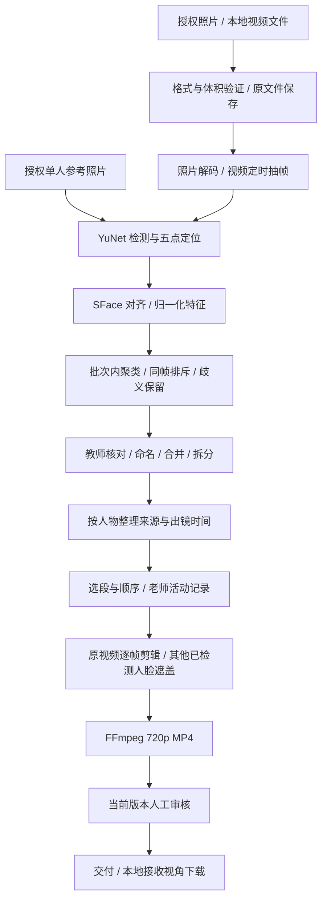

# MomentFlow v3 · 本地真实处理链路

日期：2026-10-24。代码以 `backend/momentflow/` 和 `demo/src/` 为准。

## 数据流

## 实现

- FastAPI 提供同源本地 API，Vite 在开发环境代理 `/api`。两个服务均绑定 loopback。
- CPU 推理使用 OpenCV FaceDetectorYN、FaceRecognizerSF。模型固定 OpenCV Zoo commit `48b10fa505aeb51fbd127fc60a5c660040e823b7`，下载校验完整 SHA-256。
- 使用 cosine ≥0.45 的保守完全链接候选与 0.06 歧义间隔，不沿弱相似边无限连接。任何同一采样帧同时出现的不同检测人脸不能自动合并。相似度不是身份概率。
- 新素材增量分析，已有人物组保留；新匹配会要求重新核对。参考档案给出姓名与比对特征，不替代对新出镜切片的人工确认。
- 每个脸切片关联原媒体 ID、时间、框、检测质量。低质量特征缺失时不生成身份猜测。源媒体、参考档案、脸观察、人物组、片段和输出分别保存。
- 从目标出镜采样点建立紧邻时间窗口，相邻窗口可合并；不跨越明显无目标观察的长间隔，单段最多 5 秒。采样可能漏掉短暂出镜，并非全量跟踪。
- FFmpeg 从真实源视频的对应时间读取帧；照片插入 3 秒。每个输出视频帧重新做人脸检测与目标特征匹配；检测到的其他/不确定人脸像素化。未检测到的人脸无法保证被遮盖，仍要求教师复核。
- 后台单工作线程运行分析/渲染并保存进度，可取消；输出先写临时目录，完成后登记结果，取消/失败不发布半成片。重启中断任务标为失败。
- 项目 manifest 原子落盘，特征仅保留于服务端本地数据目录。签名本地会话隔离项目，不向客户端返回特征、私有文件路径。
- 输出记录 `[analysis_version, person.revision]`。导入/分析/纠错改变数据版本，修改姓名/记录及每次重新生成改变人物版本；过期输出不可预览/领取。审核和交付是独立步骤。

## 试验边界

幼儿园样例使用三名虚构儿童的两张生成照片、三份显式参考档案及一段照片推镜合成视频。人物分组来自模型实际推理，不来自固定名单映射；这些样例不能支持真实儿童场景的识别准确率结论。

真人视频测试使用 MIT 授权 OpenCV webcam 示例，包含真实转头动作。保守策略可能将同一人的不同角度拆分成多个组，测试通过人工核对合并后验证完整剪辑流程，不通过降低阈值制造“一次自动成功”的结果。

目前没有实时监控接入、跨摄像头跟踪、多模态事件选择、自动成长评估、原声音轨、云端存储、真实监护账号、跨设备领取或支付。现有实现是可运行的本地处理版本，生产部署还需要独立的组织权限、监护关系、资源策略与实地效果验证。

## 技术来源

- [OpenCV 人脸检测与识别官方教程](https://docs.opencv.org/4.x/d0/dd4/tutorial_dnn_face.html)
- [YuNet 固定版本源码与 MIT 许可证](https://github.com/opencv/opencv_zoo/tree/48b10fa505aeb51fbd127fc60a5c660040e823b7/models/face_detection_yunet)
- [SFace 固定版本源码与 Apache 2.0 许可证](https://github.com/opencv/opencv_zoo/tree/48b10fa505aeb51fbd127fc60a5c660040e823b7/models/face_recognition_sface)

官方模型基准不等于本产品在幼儿园实拍数据上的效果，当前不引用它作为儿童识别准确率。
