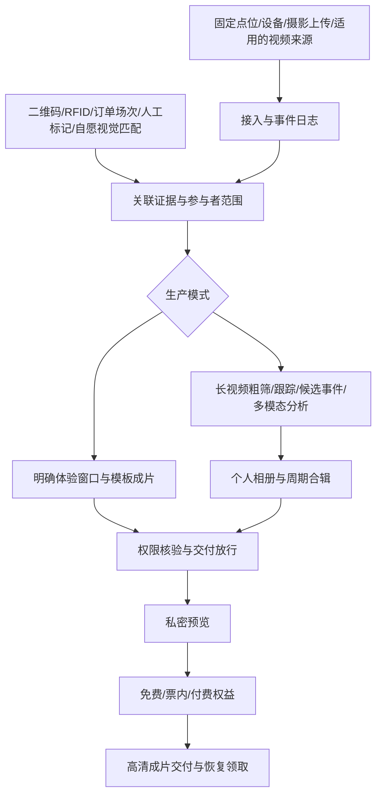

# MomentFlow · 拾光｜个人体验影像平台 v2

设计日期：2026-10-24。状态：产品方案与视觉概念，尚未实现应用。MomentFlow 为工作名，尚未完成商标/域名核验。市场依据见 [跨场景调研](research/cross-scenario-landscape-2026-10-24.md)与[市场深入比较及切入建议](research/market-entry-deep-dive-2026-10-24.md)。收费、处理时延和试点阈值均为待验证假设。

## 1. 重新定义产品

**让一次体验里属于你的照片和视频，自动汇成可以领取、保存或购买的个人回忆。**

服务场馆、体验项目、营地及活动组织者。产品管理采集、人物/场次关联、选材、成片和私密交付；按运营模式提供免费领取、票内包含或付费解锁。

幼儿园成长周记是长期活动模式中的一个场景。教育评价不是跨场景主产品，也不应成为全部游客的身份模型或默认输出。

### 核心设计变化

| 原幼儿园版 | 跨场景设计 | 必须保留的区别 |
|---|---|---|
| 园所、班级、孩子为中心 | 组织、场馆、项目/活动、参与者为基础 | 幼儿园仍有班级、监护人和教师审核，不改名成“游客订单”硬套 |
| 按孩子人脸归档 | 场次/设备/二维码/RFID 优先；视觉匹配按需 | 匹配证据和媒体领取权限独立 |
| 每周视频 | 单次纪念片、个人相册、周期合辑 | 即时体验和周期编辑使用不同交付工作流 |
| 教师审核后发家长 | 场馆规则放行或工作人员复核后领取 | 儿童长期记录继续由授权教师审核 |
| 园所年费 | 场馆基础费/处理额度/销售服务费可组合 | 首版选一个清晰收费方案，不同时自建复杂分账系统 |

## 2. 客户和首个突破口

目标客户必须拥有实际拍摄授权、稳定的素材入口和交付/收费触点。优先访问已有照片销售、摄影服务或纪念视频需求的运营商。

**默认首个试点：一个有固定起止、少量拍摄点的体验项目，例如卡丁车、滑索或山地车。** 用体验码建立归属，生成 30–60 秒纪念片并交付给游客。时长为测试起点，不是质量保证。

选择理由：场次和媒体边界容易测量，体验后即时领取/购买有公开商业先例，可以验证完整交易与交付，而不先承担全园自由游 Vlog 的覆盖问题。进一步优先已拍摄、已收费或有明确影像交付义务的运营商；不将“所有卡丁车/滑索都愿意买”作为假设。国内人脸检索、找视频和快剪已有低价供给，需对照现有流程证明新增价值。

若已经拥有幼儿园/营地渠道，则保留其试点，用同一素材底座验证周期合辑。选择客户应以渠道与素材条件为依据，不因为跨场景定位而频繁更换试点对象。

## 3. 三种内容产品、两套流程

| 内容产品 | 触发 | 接收者 | 例子 |
|---|---|---|---|
| 个人体验相册 | 素材陆续就绪 | 本次参与者/经过验证的同行组 | 一次游园或赛事中的个人照片包 |
| 单次纪念片 | 单次体验完成 | 本场次参与者/同行组 | 滑索 48 秒、卡丁车 46 秒纪念片 |
| 周期合辑 | 活动结束或约定周期 | 授权参与者/监护人 | 结营片、研学日记、幼儿园周记 |

流程 A 为“体验绑定 → 定点采集 → 快速成片 → 私密预览 → 领取/购买”。流程 B 为“活动素材 → 人物与事件整理 → 编辑审核 → 周期交付”。

二者共用媒体、关联、授权、版本和交付；运营页面与放行条件分别设计。A 不应要求游客等待教师周审，B 也不能把未经核验的儿童观察自动发出。

## 4. 用户与入口

### 运营端 Web

站点/活动选择器＋五个核心入口：

1. **今日交付 / 本期交付**：按场次或周期看素材与成片，优先处理会阻塞交付的异常。
2. **素材与成片**：时间、来源、参与者、场次、版本与证据；按权限检索。
3. **项目与点位**：相机/上传源、触发规则、体验码绑定、模板与上线检查。
4. **订单与领取**：实收、权益、领取与退款状态；未售素材成本单独统计。
5. **组织设置**：成员、权限、用途授权、接收范围、留存与外部系统配置。

运营商首页只展示与当前工作相关的信息：未绑定素材、需要复核的场次、可交付影片和交付故障。财务视图才显示销售漏斗，不把看板做成泛用 AI 功能目录。

### 工作人员手机入口

扫码/读码绑定场次、核对参与者/同行组、开始或结束采集、上传摄影素材、处理少量疑点。现场操作应与上客安全和设备安装流程协调，不让游客在项目运行中操作手机。

### 游客 H5 / 可嵌入小程序页面

通过私密体验码、已验证订单或组织者邀请进入；完成必要告知和授权后，看本人/授权同行内容。默认不要求安装独立 App。园区票务和营地家长渠道可嵌入同一交付组件。

未成年人由适当监护关系管理；照片/人脸相似度本身不构成监护关系或账号认证。

## 5. 即时体验完整旅程

### 5.1 体验前

游客购票或到达体验点 → 获得私密体验码 → 绑定本场次参与者和同行范围 → 选择/确认影像服务用途与交付方式 → 工作人员把设备、座位或拍摄点映射到本场次。

一期试点可使用单独影像领取码，不要求先替换全园票务。人脸检索是可选辅助，不要求每个游客提供自拍。非人脸路径仍需有效的内容使用和接收授权。

### 5.2 采集

项目触发、设备开始/结束或工作人员操作生成 CaptureSession。记录场次、设备、拍摄点、时间、参与者/同行组和原媒体。机位与座位必须经现场标定；多人同车/同船不能直接将整段媒体标记为某一个人独占。

网络差时本地缓存并展示真实状态。项目结束后重连补传，保留采集事件序号；一次故障不影响下一场身份绑定，设备换人前明确清空旧映射。

### 5.3 自动生产

可信场次/设备绑定 → 提取完整体验窗口 → 检查素材可用性和拍摄范围 → 按已审核模板编排 → 生成带预览标记的私密版本。

固定项目优先使用触发时间、点位和确定性模板。多模态模型可用于选材、活动说明或复杂素材理解，但不强制阻塞每份实时出片。不使用 AI 虚构游客没有经历的画面；共享场景镜头须标明是环境素材，不伪装成本人实拍。

### 5.4 规则放行与人工复核

已验证的绑定机制、明确授权范围、素材检查和批准模板可以按场馆规则自动生成可领取预览；试点阶段仍全量复核，验证稳定后才调整放行范围。

身份冲突、多人同框范围不符、无法读码或设备映射异常时进入隔离待办。疑似错误素材不能先对游客曝光再询问“是不是你”。游客可以在合法范围内核对已确认的场次信息，工作人员在受控界面处理原片。

### 5.5 预览与购买

游客打开私密相册 → 观看短预览和明确套餐 → 选择免费领取、票内已含或付费购买。套餐列清成片、照片、清晰度、交付范围和可下载期限，不默认附加订阅或公共发布授权。

初始交易优先接入运营商现有 POS/订单系统，由运营商作为销售方收款；平台同步订单与权益并按合同结算软件费。若未来由平台代收并向多方分账，必须单独设计资金流、退款责任、税务与支付合规，不把简单订单表当作分账系统。

价格展示按实际售卖单位：个人包或同行包。购买前让游客确认包含的参与者范围，不能以购买资格替代所有出镜者的可交付授权。

### 5.6 交付与恢复

支付回调核验成功/票内权益确认后发放下载权益 → 最终高清文件就绪 → 提供短时下载链接和恢复领取入口。支付成功但成片未就绪时说明进度与可执行的处理方式，不显示虚假的“已交付”。

支持找回已购买内容、补交迟到素材、误绑申诉和按适用规则退款。下载期限、链接有效期和服务器存储期限分开说明，过期前通知须符合实际通知授权。

## 6. 周期活动完整旅程

组织者创建活动/周期、名单与授权 → 摄影/教师上传照片和视频，接入适用的固定来源 → 视觉与时间信息辅助归人 → 同一活动建立多参与者证据 → 自动选择不同日期/项目的素材 → 编辑或教师核验 → 按参与者或授权同行范围交付。

保留初版的身份纠正、多老师版本冲突、来源时钟修正、素材不足处理和明确交付清单。班级、监护人、老师寄语是教育场景配置，不进入每个乐园游客的必填字段。

成长报告仍是独立垂直功能：使用充分的观察证据与教师复核，不能从只选精彩片段的游客/儿童合辑推导能力或心理状态。

## 7. 关键页面

### 运营交付工作台

按“需要处理 / 制作中 / 可交付 / 已交付”组织。每行显示场次/周期、参与者范围、拍摄来源、影片状态和下一步。选中场次右侧核验；顶部主动作准确说明将交付哪一批，跳过项目及原因可见。

自动规则、人工复核、模板版本可追溯。不可在未解决的阻塞条件下批量放行。

### 成片工作室

大预览＋简化片段条＋场次/参与者核验栏。支持查看原片、更换片段、调顺序、微调起止和改字幕。单项目无需复杂专业剪辑器，多日合辑可按活动章节编排。

用户修改后生成草稿新版本，绑定原版本的审核和渲染不能继续覆盖。内容改变不自动继承旧发布确认。

### 游客私密相册

场馆品牌 → 体验时间/项目 → 纪念片预览 → 精选照片 → 套餐详情与领取动作。免费、票内包含、付费三种状态明确；已经购买则主按钮变成“查看/下载”，并提供恢复领取。

分享默认分享本人允许传播的成片或受控访问页，不能把长期领取凭证直接公开。能否转发、多人的出镜范围和水印按活动授权决定。

### 场次关联纠错

显示来源设备、读码/触发时间、候选关联与可回看证据；允许修正设备映射、分割重叠场次、移出影片或标记无法确认。修改作用范围必须明确，且使所有受影响草稿或交付权限重新评估。

### 点位上线检查

检查触发、构图、光线、设备与座位映射、时间偏差、网络/缓存、授权范围、模板及演示订单恢复。不能仅凭摄像头在线就判定点位可营业。

## 8. 技术架构

### 分层职责

- 接入层：文件校验、上传/缓存、原始时间和校准时间、事件唯一 ID、设备配置版本。
- 关联层：输入证据、候选关联、明确确认/拒绝状态；不以单一置信分数代替授权与认证。
- 媒体层：原件、代理、候选区间、照片组、共享场景素材、生成结果和血缘。
- 内容层：模板快速路径；非结构化内容才引入检测、跟踪、语音转写和多模态分析。
- 放行层：审核版本、权利范围、自动规则版本、阻塞原因。
- 交易交付层：套餐、订单、权益、下载、退款/撤回和通知，保证重试幂等。

固定点位优先与已有摄影/集成商协作。首版不承诺控制所有游乐设备、任意 NVR 或自研全套相机。对既有安全系统的访问是另行授权与适配，不侵入游乐控制逻辑。

## 9. 数据模型与不变量

| 对象 | 关键责任 |
|---|---|
| Organization / Venue | 租户、站点、成员与运营权限；同集团也不默认共享个人身份库 |
| Experience / Activity | 单次体验项目或有时间边界的活动；设置采集、交付模式与模板 |
| ExperienceSession / ActivityPeriod | 一次参与场次或周期合辑范围，区分两种业务单位 |
| Participant / Party | 参与者、有效同行关系和可接收范围；姓名可选，关系有期限 |
| CredentialBinding | 私密体验码/RFID/订单等到场次与设备的映射，独立于登录凭证 |
| CapturePoint / CaptureSession | 点位、设备、采集窗口、配置版本和参与场次 |
| MediaAsset / Segment | 原媒体、时码、代理、区间、来源与留存；一份媒体关联多参与者 |
| AssociationEvidence | 关联方法、原始事件/视觉结果、候选、人工确认及纠正记录 |
| Consent / ContentRights | 处理用途、拍摄及交付范围、接收方、有效期与撤回 |
| Story / StoryVersion | 选材、顺序、字幕、模板、渲染和审核版本 |
| Package / Order / Entitlement | 商品和实收状态、购买/票内资格、允许下载的具体发布版本 |
| Delivery / Audit / Job | 领取与通知、访问审计、输入版本、重试和成本归因 |

不变量：

1. 所有访问在服务端按租户、活动和接收权限校验，猜到媒体 ID 或人脸匹配不获得访问权。
2. 扫码说明某凭证在某时刻被读取，仍需正确的设备/座位映射；多证据冲突时不按“最新覆盖”放行。
3. 一个媒体可关联多人；一个参与者可属于多个不同时间的同行组，但不能无限扩大组员的历史访问。
4. 关联、内容、权利或模板改变会使受影响的审核/预览/交付资格重新评估。
5. 不默认跨活动永久建立游客人脸档案；幼儿园长期参考库是明确授权的场景特例。
6. 已发布版本不可变；补片或改稿产生新版本，并明确旧购买权益如何适用新版本。
7. 支付成功、权益有效、媒体就绪、下载成功是四种独立状态。
8. 授权撤回按血缘影响原媒体、候选、成片、预览、权益和链接；不能只删自拍。已下载副本无法远程召回。

## 10. 状态与故障恢复

| 异常 | 产品行为与恢复 |
|---|---|
| 未绑定或错绑设备 | 原片隔离，工作人员核对场次；不公开候选人画面 |
| 多人同车/同船范围不符 | 换角度、裁切/遮挡或不交付，不能把同车都当授权同行 |
| 读码重复/事件乱序 | 事件去重并按设备序列与校准时间关联；保留可审计的修正 |
| 断网/素材迟到 | 现场显示待同步；重连补传，同一场次增量合并，不能重复收费/通知 |
| 没拍到或不可用 | 明示缺片，提供实际可用替代或按约退款，不用虚构画面补齐 |
| 模型分析超时 | 快速路径可不依赖该步骤；需要分析的内容保留待处理，不编造结果 |
| 支付回调重放/先到后到 | 校验签名、订单与金额，幂等发放权益；不由客户端“支付成功”解锁 |
| 已付但渲染失败 | 保留权益和明确处理状态，重试/客服/退款路径可达 |
| 游客丢失体验码 | 通过运营商已有订单验证或受控工作人员流程找回；不能只报时间就拿别人媒体 |
| 分享导致凭证泄露 | 分享页与领取凭证分离，支持撤销；短时媒体链接和访问范围复核 |
| 退款/撤回/留存到期 | 分别更新订单、权益、在线可见性与文件清理；保留必要审计，不声称召回下载件 |

## 11. 版本范围与试点门槛

### 首个完整闭环

一个场馆、一个体验项目、一种可信场次绑定方式、少量批准拍摄源、一套纪念片模板、游客私密领取页、一个运营商订单渠道，以及完整的错绑/失败/恢复处理。

接受照片和视频，既支持已有摄影素材，也支持一个约定接入路径。可免费/票内交付或使用运营商现有 POS 购买；没有真实支付接入前，演示订单明确标注，不能展示假成交。

初始试点全部人工确认；验收后按点位逐步启用已验证规则自动放行。无须为了“跨场景”一次做全园、全部行业、复杂营销 CRM 或自营硬件。

### 接下来验证

1. 增加第二个点位/项目，验证映射、配置和部署能否复用，形成一次游园合辑。
2. 选择一期营地或研学，验证照片＋非结构化视频周期合辑及多人授权。
3. 保留幼儿园场景作为周期模式的适配，不改变其教师确认与监护关系边界。

商业试点不按计划日期强制跨过质量门槛。具体工期在源设备、支付和团队条件确认后估算。

## 12. 计费、成本与指标

### 计费设计

运营商优先使用“基础软件/处理额度＋按实际销售或交付计费”的透明合同。硬件安装、现场支持、存储、超额处理独立说明。未售出的采集/分析和预览不是零成本，应纳入基本额度或单位经济。

游客可测试单次纪念片、照片＋视频包、当日多项目合辑。概念图中的 49 元仅为示例，先试验可看内容、价格和交付时机，不把海外套餐价格当中国定价依据。

### 经营漏斗

可服务订单 → 有效采集 → 正确关联 → 私密相册到达 → 有效预览 → 购买/票内领取 → 高清交付 → 自愿分享。每层使用明确、可去重的购买单位，同时报告拒绝参与、缺片和故障分母。

GMV、运营商实收、平台收入、贡献毛利分别报告。退款回写收入；不能把所有游客、所有照片或重复下载都算成新订单。

### 初始验收目标（须试点确认）

- 所有待交付样片全量检查，发现错绑即阻塞；任何未授权媒体曝光视为严重故障。
- 采集到首个可领取预览，以端到端 P50/P95 测量，固定试点项目可将 P95 不超过 5 分钟作为初始目标；不是全行业 SLA。
- 报告有效采集率、正确关联率、未知/待复核率、漏片率，不能只报告已成功成片样本。
- 记录每 100 次体验的现场操作与异常处理工时，以及峰值排队和设备周转影响。
- 若接入购买，使用实收、退款后数据判断价值；没有购买则以付费试点合同与运营工时验证，不冒充游客付费证明。
- 单位成本覆盖未售素材、预览、高清转码、分发、设备摊销和支持；贡献为正且能支持现实接入成本。

## 13. 视觉探索与历史保留

本轮探索运营交付工作台、成片工作室和游客领取页三个关键触点。它们是同一新产品的不同页面概念，尚未实现交互。

历史 [幼儿园 v1](archive/kindergarten-product-design-v1.md) 和 [原视觉资料](../design/archive/kindergarten/generation-prompts.md)保留为垂直场景参考，不再作为跨场景产品默认架构。

## 14. 下一项真实验证

获得一个体验项目的合法素材、实际设备/场次日志和运营方现有收费/交付流程，验证绑定、成片、错误恢复和游客接受度。若无法获得可控拍摄来源，优先与摄影方或已有影像系统合作，不从全园监控自动寻找游客开始。
